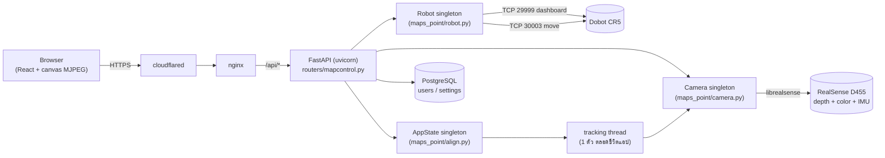
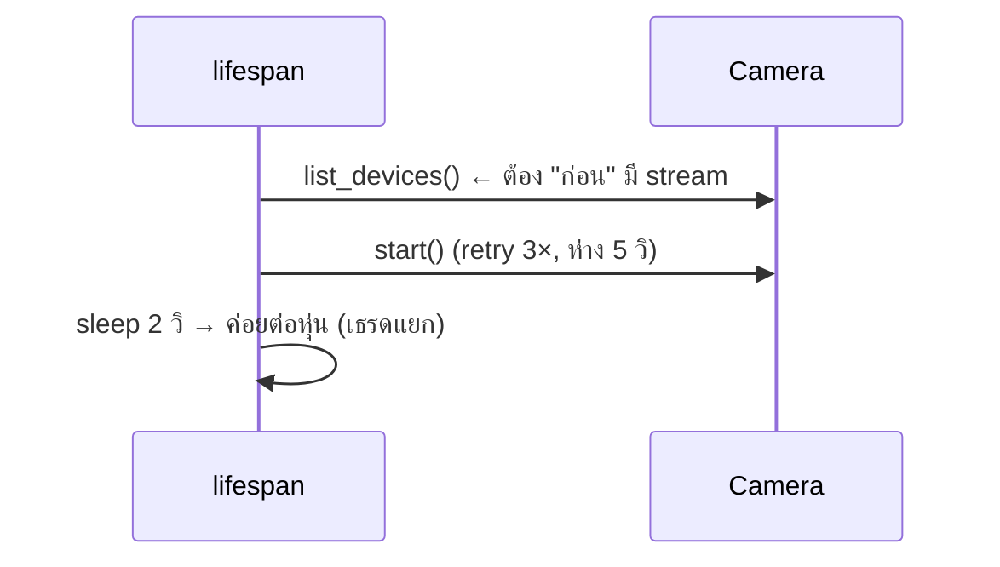

# 🔧 Backend: Camera + Dobot — สรุปการออกแบบ

> เอกสารสำหรับพรีเซนต์ — อธิบายว่า **ทำไมเลือกทำแบบนี้**, **ข้อดี**, **ข้อเสีย**, และ **อะไรแทนได้**
> ขอบเขต: เฉพาะ subsystem กล้อง (RealSense D455) และหุ่น (Dobot CR5) ใน backend
> อัปเดต: 2026-09-17

---

## 0. ภาพรวม

**3 ตัว singletons ระดับโมดูล** (`mapcontrol.py:35-38`): `robot`, `cam`, `state` + tracking thread 1 ตัว
→ ทั้งแอปมี "กล้องหนึ่งตัว หุ่นหนึ่งตัว สถานะหนึ่งชุด" — ง่ายต่อการให้เหตุผลเรื่อง concurrency

| ตัวเลขที่วัดได้จริง (Pi 5, 4 cores) | ค่า |
|---|---|
| CPU backend ตอนสตรีม (2 viewer) | 46–52% ของ 1 core |
| แบนด์วิดท์ต่อ viewer | 390 KB/s (640×360 @15fps, q70) |
| capture | 848×480 @30fps (depth z16 + color bgr8 + IMU) |
| latency ของ MJPEG (LAN) | ~100–200 ms |

---

## 1. Camera Subsystem

### 1.1 กล้องมีเจ้าของคนเดียว + shared buffers

**เลือกแบบนี้**: เธรดเดียว (`Camera._capture_loop`) เป็นเจ้าของ hardware แต่เพียงผู้เดียว —
`pipe.wait_for_frames()` → `rs.align` → เขียนลง buffer กลาง (`_color_buf`, `_depth_buf` rolling, `_accel_buf`)
ผู้บริโภคทุกคนอ่านผ่าน `get_latest_frames_ref()` (zero-copy, อ่าน reference) หรือ `get_latest_frame()` (copy)

| ทำไม | ข้อดี | ข้อเสีย | แทนได้ด้วย |
|---|---|---|---|
| librealsense **ไม่ thread-safe** — เปิด `rs.context()`/pipeline ซ้อนขณะสตรีมอยู่จะ **deadlock** (เจอจริงตอนทำ device scan) | • หลาย endpoint ใช้กล้องพร้อมกันได้ไม่พัง • frame ใหม่สุดถูกแชร์ ไม่ต้องแย่งกันเปิดกล้อง • อ่าน zero-copy → ไม่มี copy ต่อผู้บริโภค | • buffer เป็น array ที่ **ห้าม mutate** (ผู้บริโภคต้อง `.copy()` เองถ้าจะวาดทับ) • มี lock 3 ตัว — ต้องมีวินัยเรื่องลำดับการล็อก • เธรดตายแล้วสตรีมเงียบ (ไม่มี watchdog) | เธรดต่อ consumer + mutex (แพงกว่า) · multiprocessing + shared memory (กัน GIL ได้ แต่ซับซ้อน) · ให้ librealsense `callback` แล้วกระจายต่อ |

### 1.2 MJPEG บน HTTP เป็น transport ของวิดีโอ

**เลือกแบบนี้**: `multipart/x-mixed-replace` — encode เป็น JPEG ทีละเฟรม ส่งตรง ๆ

| ทำไม | ข้อดี | ข้อเสีย | แทนได้ด้วย |
|---|---|---|---|
| • ไม่ต้องมี decoder ฝั่ง client เลย → ``/canvas ใช้ได้ทันที • **ไม่มี H.264 encode บน Pi** (ที่ไม่มี hardware encoder ดี ๆ) • latency ต่ำ, เริ่มเล่นทันที • เป็น HTTP ธรรมดา → ผ่าน nginx/cloudflared ได้เลย | • ง่ายสุดในบรรดาทางเลือก • debug ง่าย (เปิด URL ตรง ๆ ก็เห็นภาพ) • client เป็น React ธรรมดา ไม่ต้องมี lib | • **แบนด์วิดท์สูง** — JPEG ต่อเฟรม ไม่มี inter-frame compression (390 KB/s ต่อคน) • ยึด 1 เธรด threadpool ต่อ 1 viewer ตลอด session • ไม่มีเสียง/ไม่มี adaptive bitrate | **WebRTC** (latency ต่ำสุด + bandwidth ดีสุด แต่ต้องมี signaling + SFU — งานเพิ่มเยอะ) · **H.264/H.265 + MSE ผ่าน WebSocket** (bandwidth ~1/10 แต่ต้องใช้ ffmpeg/gstreamer บน Pi) · **HLS** (latency หลายวิ ไม่เหมาะกับ teleop) |

**ตัวเลขหลัง optimize** (encode ครั้งเดียวแชร์ทุก viewer + idle 15fps/25fps ตอน align):

| | ก่อน | หลัง |
|---|---|---|
| CPU (2 viewer) | 84–89% | **46–52%** |
| CPU ต่อ viewer เพิ่ม | +12–13% ✗ | **~0** (แชร์ encode) ✓ |
| fps | 25 ตลอด | 15 ปกติ / 25 ตอน align-draw |

### 1.3 Depth → Color alignment + rolling depth buffer

**เลือกแบบนี้**: `rs.align(rs.stream.color)` ทุกเฟรม → buffer depth แบบ rolling (config `DEPTH_N_FRAMES`)
ทุกการวัด depth ต้องผ่าน `_wait_depth_buf(min_frames=3)`

| ทำไม | ข้อดี | ข้อเสีย | แทนได้ด้วย |
|---|---|---|---|
| • ทุกพิกเซล depth ต้องตรงกับพิกเซล "สี" ที่ผู้ใช้คลิก • ค่า depth มี noise → median/trimmed-mean จากหลายเฟรมนิ่งกว่า • บังคับรอ ≥3 เฟรม → กันการอ่านค่า **ผสม raw/aligned** | • ค่าที่วัดได้เสถียร (rmse ~0.4–0.7 mm ในเงื่อนไขดี) • วัด Z ผิวงานได้โดยไม่ต้องมีไฟล์ calibration เก่า | • **`align.process()` คือจุดกิน CPU หนักสุดใน capture** (~11% ของ 1 core) • latency ของ depth = อายุ buffer (สูงสุด N เฟรม) • memory ~800KB × N | align เฉพาะตอนใช้ (ประหยัด CPU แต่**เสี่ยง buffer ผสม** — ต้องทำ all-or-nothing) · สร้าง depth map เป็นของตัวเองด้วย intrinsics/extrinsics (คุมได้ แต่ต้อง calibrate เอง) |

### 1.4 การหาวัตถุ: depth-only region growing (ไม่ใช้ optical flow)

**เลือกแบบนี้**: `sample_plane_region_grow()` — fit plane จาก seed patch → ขยาย region ตามเงื่อนไข "depth ตรงกับที่ plane นั้นทำนาย" → เอา connected component ที่แตะ seed

| ทำไม | ข้อดี | ข้อเสีย | แทนได้ด้วย |
|---|---|---|---|
| วิธีเดิม (4 มุม + `fillPoly` + Lucas-Kanade optical flow) ทำให้มุมที่ track **ไหลไปเกาะพื้นหลัง** ที่ดูคล้ายกัน แล้ว **rmse กระโดด 0.65 → 4.38 mm ในก้าวเดียว** (เกิดบนเครื่องจริง) — ไม่มีอะไรตรวจสอบได้ | • **ผิดได้ยาก** — พิกเซลพื้นหลังเข้ามาไม่ได้ เพราะไม่อยู่บนระนาบวัตถุ • แต่ละรอบคำนวณสด ไม่มีการสะสม → **drift ไม่มีที่ซ่อน** • ไม่ใช้สี → ไม่พังตามแสง | • พึ่งคุณภาพ depth (วัตถุโปร่งใส/ดำด้าน = พัง) • กิน CPU (median + connectedComponents + PCA) • ต้องมี seed ที่แตะวัตถุ | optical flow (เร็วกว่า แต่ drift) · **segmentation/YOLO** (ต้องมีโมเดล + GPU/NPU) · **ArUco/AprilTag** ติดบนวัตถุ (แม่นสุด แต่ต้องแปะ marker) |

### 1.5 AutoStart ตอนบูต — "ลำดับ" คือหัวใจ

| ทำไม | ข้อดี | ข้อเสีย | แทนได้ด้วย |
|---|---|---|---|
| enumerate **ก่อน** เริ่มสตรีม ไม่งั้น librealsense deadlock · กล้องก่อนหุ่นเพื่อให้หน้าเว็บเห็นภาพเร็ว | • เปิดเครื่องแล้วพร้อมใช้ทันที • retry ครอบ กล้อง USB หลุดกลางทางยังกู้ได้ | • ถ้ากล้องค้างตอน start จะยืดเวลา boot • เป็น policy ตายตัว ไม่มีการตั้งค่าจาก UI | เปิดกล้องเองผ่านปุ่ม (ช้ากว่าแต่คุมได้) · systemd unit แยกสำหรับกล้อง · health-check loop ที่คอยปลุกกล้อง |

---

## 2. Dobot Subsystem

### 2.1 สื่อสาร 2 พอร์ต TCP (29999 dashboard + 30003 move)

**เลือกแบบนี้**: `Robot` ครอบ SDK (`dobot_api_v3`) — `DobotApiDashboard` (29999) สำหรับอ่านสถานะ/ตั้งค่า และ `DobotApiMove` (30003) สำหรับสั่งเคลื่อนที่

| ทำไม | ข้อดี | ข้อเสีย | แทนได้ด้วย |
|---|---|---|---|
| โปรโตคอล Dobot แยกหน้าที่ชัดเจน: คำสั่ง config/query ไปพอร์ต dashboard, คำสั่ง motion ไปพอร์ต move — ใช้ socket คนละเส้นจะไม่บล็อกกัน | • อ่าน pose ถี่ ๆ ไม่ถ่วงคำสั่งเคลื่อนที่ • log แยกได้ (ดูด้านล่าง) • ต่อใหม่/reconnect ทำได้อิสระต่อพอร์ต | • ต้องจัดการ 2 socket (2 จุดที่พังได้) • **ไม่มี heartbeat** — สายหลุดแล้วรู้ตัวช้า | พอร์ต **30004** (servo/realtime feedback ความถี่สูง) ใช้ทำ teleop ได้ แต่ต้องเขียน protocol เอง · Modbus TCP · สั่งผ่าน script/Lua บนตัวคอนโทรลเลอร์ (ตัดปัญหา round-trip แต่ debug ยาก) |

**บทเรียนสำคัญ → `SOCKET_TIMEOUT_S = 3.0`**: เดิม `socket.connect()` **ไม่มี timeout** — หุ่นออฟไลน์แล้วค้าง ~2 นาที (TCP SYN retry)
ผลคือ request ค้างพร้อม **ถือ DB connection ไว้** → pool หมด → ล็อกอินไม่ได้ → แอปตายทั้งตัว
หลังแก้: connect ที่ล้มเหลวใช้เวลา **3.01 วิ** และยิงพร้อมกัน 10 ครั้งเสร็จใน **3.03 วิ** (pool ไม่ขยับ)

**การ route log ไปหน้าเว็บ** (`robot.connect()`): เดิม SDK `print()` ทิ้ง → ตอนนี้ส่งเข้า `robot_log()` แต่ **กรอง** `GetPose`/`RobotMode`/`GetErrorID`/`ServoP` ออก
เพราะถูกเรียกที่ ~1–100Hz จะท่วม panel โดยไม่มีประโยชน์

### 2.2 การเคลื่อนที่ 4 โหมด (เลือกใช้ตามงาน)

| โหมด | ใช้ทำอะไร | ทำไมต้องโหมดนี้ | ข้อเสีย |
|---|---|---|---|
| `movl()` — MovL absolute | mark grid, goto, ยิงเป้าในโหมดวาด | ไป "พิกัดเป้าหมาย" แบบระบุตำแหน่งจริงใน XYZRxRyRz → ซ้ำได้ | ช้ากว่า (เดินเส้นตรง) · ต้องรอ stable ทุกครั้ง |
| `movj()` — joint | ย้ายระยะไกล / `move_to` | **เร็วสุด** เพราะขยับทีละข้อต่อ ไม่ต้องแก้ IK ตามเส้น | เส้นทางไม่รู้ล่วงหน้า → **ไม่ปลอดภัยถ้ามีสิ่งกีดขวาง** |
| `rel_movl_tool()` — RelMovLTool | หมุนแก้ tilt/roll ตอน align | หมุน**รอบปลายโพรบ**ในกรอบ tool (dx=dy=dz=0, Tool 1) → ปลายอยู่กับที่ไม่ไถผิวงาน | ต้องมั่นใจว่า tool frame ถูกเลือกอยู่ (ดู 2.4) |
| `servo_stream()` — ServoP | replay stroke ที่วาด (ลากเส้นต่อเนื่อง) | ส่งคำสั่งต่อเนื่อง ~100Hz → **เส้นเรียบ** ไม่กระตุกเป็นท่อน ๆ | ถ้าเน็ต/เธรดหน่วง เส้นจะสะดุด · log ทุกคำสั่งไม่ได้ (ท่วม) → ต้องกรอง |

| ทางเลือกอื่น | แลกกับอะไร |
|---|---|
| ใช้ `movl()` อย่างเดียวทุกงาน | ง่าย/ปลอดภัยสุด แต่ align จะไม่หมุนรอบปลายโพรบได้ และวาดจะช้า+หยุดเป็นช่วง |
| ใช้ `servo` ทุกงาน | เรียบสุด แต่ไม่มีการยืนยันว่าถึงเป้า → ไม่เหมาะกับงานที่ต้องแม่น |
| ส่ง trajectory ทั้งเส้นให้คอนโทรลเลอร์รันเอง | ไม่ขึ้นกับเน็ต แต่ debug จากฝั่งเว็บได้ยาก |

### 2.3 จะรู้ได้ยังไงว่า "หุ่นหยุดแล้ว" — `_wait_stable()`

ทำงาน 2 เฟส: (1) รอจนเห็นว่ามีการขยับจริง (เกิน `tol×5`) (2) รอให้ **ทั้ง 6 ค่า (X Y Z Rx Ry Rz)** นิ่งภายใน `tol` ต่อเนื่อง `STABLE_WIN` ตัวอย่าง

| ทำไม | ข้อดี | ข้อเสีย | แทนได้ด้วย |
|---|---|---|---|
| **ต้องดูทั้ง 6 DOF** เพราะการหมุน Rx/Ry/Rz หรือ J6 ล้วน ๆ ทำให้ XYZ **ไม่เปลี่ยนเลย** → ถ้าดูแค่ XYZ จะคืนค่า "หยุดแล้ว" ทันทีทั้งที่ยังหมุนอยู่ | • ไม่มีการยิงคำสั่งทับตอนหุ่นยังขยับ • ใช้กับ jog แบบไหนก็ได้ | • เป็น **polling** — สิ้นเปลือง round-trip และ latency = รอบ poll • มี timeout (`STABLE_TIMEOUT`) → งานที่ช้ามากอาจตัดจบก่อนถึง | อ่าน ack ของ MovL (แต่ Dobot ไม่การันตีว่า "นิ่งแล้ว") · อ่าน joint speed จากพอร์ต 30004 (แม่นสุด แต่ protocol หนัก) · fixed delay (ง่ายแต่ช้า+เปราะ) |

### 2.4 Re-assert Tool/User frame ก่อนทุกการเคลื่อนที่ absolute

| ทำไม | ข้อดี | ข้อเสีย | แทนได้ด้วย |
|---|---|---|---|
| เดิมเชื่อว่า `RelMovLTool(tool=N)` (ที่ align ใช้) จะไม่เปลี่ยน Tool ที่ active บน dashboard — **ผิด**: บนเครื่องจริง 2026-07-25b ปุ่ม `home` ที่เคยถูก กลับไปผิดที่ **หลัง** รัน align | • ป้องกันบั๊กที่หายากมาก (เจอเฉพาะบน hardware จริง) • ราคาถูก (~ไม่กี่ ms) | • เพิ่ม round-trip ทุกครั้งที่ย้าย • เป็นการ "ปิดอาการ" ไม่ได้แก้ที่ protocol | อ่าน Tool ที่ active กลับมาแล้ว diff ก่อน apply (round-trip เท่ากัน) · ตั้ง Tool ใหม่หลัง align จบเสมอ (เปราะ — ลืมที่เดียวพัง) |

### 2.5 Align: วัดระนาบ → หา "ทิศทางที่ถูก" ด้วยการทดลอง

**เลือกแบบนี้**: วัด tilt/roll จาก plane fit → **ทดลองหมุนเล็ก ๆ (`ALIGN_PROBE_DEG`) ดูว่าค่าดีขึ้นหรือแย่ลง แล้วเรียนรู้เครื่องหมาย** → ค่อยไล่แก้

| ทำไม | ข้อดี | ข้อเสีย | แทนได้ด้วย |
|---|---|---|---|
| ไม่มีใครยืนยันลำดับการประกอบ Euler/RPY ของ CR5 ในโค้ดนี้ → เดาไม่ได้ ถ้าเดาผิดจะ **diverge ทันที** (เจอจริง: 16.5° → 39.1° ใน 6 ก้าว) | • ทนต่อ convention ที่ไม่รู้ • ตรวจสอบได้เองว่าถูกหรือผิด • มี unit test ครอบ 3 click order | • เสียเวลาหมุนทดลอง 2–3 ครั้ง • **net rotation = 0** แต่ผู้ใช้เห็นหุ่นขยับ (ต้องอธิบาย) • เดิมใช้เกณฑ์ "ขนาดลดลง" → **ผิดเมื่อค่าเป็นลบ** ต้องเปลี่ยนเป็น signed-difference | วัด convention จากเอกสาร Dobot แล้ว hardcode (เร็ว แต่พังถ้าเฟิร์มแวร์/โมเดลต่าง) · ใช้ Jacobian จาก FK/IK ผ่านปอร์ต 30004 (เท่และ general สุด แต่ต้องมีโมเดล kinematics ครบ) |

**Guard ที่ต้องมี**: เมื่อวัตถุใกล้ขอบภาพ → `_recenter_xy(to_margin_only=True)` ขยับ**เท่าที่จำเป็น** (ไม่ลากไปกลางภาพเสมอ ซึ่งเคยทำให้ยืดแขนเกินจนชนขอบเขต IK) และเมื่อเจอ IK error 17 → `clear_error()` **ก่อนทุกรีทราย** (โหมด ERROR ของคอนโทรลเลอร์จะ **latch** — ปฏิเสธทุกคำสั่งจนกว่าจะเคลียร์)

### 2.6 วาดภาพ: grid ที่สอนด้วยมือ + bilinear (ไม่ใช้ vision→robot calibration)

**เลือกแบบนี้**: ผู้ใช้ jog หุ่นไปมุมจริงแล้วกด mark ทีละช่อง (N×M) → สร้างระนาบด้วย bilinear ระหว่าง 4 มุม → ยิง MovL ต่อจุด + ยกปากกา (`DRAW_LIFT_MM`) ระหว่าง stroke

| ทำไม | ข้อดี | ข้อเสีย | แทนได้ด้วย |
|---|---|---|---|
| **ตัดปัญหา hand-eye calibration ทั้งวง** — ไม่ต้องมีเมทริกซ์กล้อง→หุ่น ไม่ต้องกลัวว่ามันเพี้ยนตามเวลา/อุณหภูมิ | • แม่นตามจริง เพราะผู้ใช้เลือกจุดบนผิวงานเอง • ตรวจง่าย (เห็นด้วยตาว่ามาร์คถูก) • ย้ายโต๊ะ/เปลี่ยนชิ้นงาน = mark ใหม่ 4 จุด จบ | • **ต้องมีคน jog + mark ทุกครั้ง** (ช้า, ไม่ automate) • ผิวงานต้องเรียบพอให้ bilinear ใช้ได้ (โค้ง = คลาด) • ช่อง grid ห่างกันต้อง ≥ `DRAW_MIN_GRID_SPAN_MM` (5 mm) ไม่งั้นถือว่าไม่มีระนาบ → ระบบ **ปฏิเสธการวาด** • กัน mark ซ้ำ: ถ้า pose ตรงกับช่องอื่น ระบบไม่รับ | **hand-eye calibration** (calibrate ครั้งเดียว ใช้ได้ทุกชิ้น — แต่มันเพี้ยนเงียบ ๆ และต้อง calibrate ใหม่เป็นระยะ) · **plane fit + normal จาก depth** แล้วหมุน tool ให้ตั้งฉากอัตโนมัติ (เท่ แต่พึ่งคุณภาพ depth) · **homography จากกล้อง** (ง่าย แต่ใช้ได้เฉพาะมุมมองตั้งฉาก) |

---

## 3. State & Concurrency

**เลือกแบบนี้**: `AppState` เก็บทุกอย่างใน memory (points, grid, สถานะ align/draw) + เธรด tracking 1 ตัวที่รันตลอดชีวิตแอป

| ทำไม | ข้อดี | ข้อเสีย | แทนได้ด้วย |
|---|---|---|---|
| งานนี้เป็น **single-operator single-robot** — เก็บใน memory เร็วกว่า DB รอบแล้วรอบเล่า และ state พวกนี้ไม่ควรอยู่ข้ามการรีสตาร์ตอยู่แล้ว | • อ่าน/เขียนเร็ว ไม่มี round-trip • debug ง่าย (`GET /api/map/status` เห็นทุกอย่าง) • ไม่มี migration/ไม่มี schema | • **`docker restart` = mark หายหมด** (จุด align, grid) ✗ • หลายผู้ใช้พร้อมกันแชร์ state เดียวกัน (จงใจ แต่ต้องรู้ตัว) • เธรด tracking ไม่มี watchdog | เขียนลง DB/settings (อยู่ข้ามรีสตาร์ต แต่ช้า+เป็นภาระ) · Redis (กลาง ๆ) · file JSON snapshot (ง่ายสุดถ้าต้องการแค่ "จำได้") |

**บทเรียน concurrency ที่สำคัญ 2 ข้อ**
1. **DB session อยู่ตลอด request** → endpoint ที่บล็อกนาน (ต่อหุ่น/สตรีม MJPEG ที่เป็นนาที) ถือ connection ค้างไว้ ✗ → แก้โดยคืน connection ก่อนเข้า handler (`await db.close()`)
2. **งานบล็อกต้องมี timeout เสมอ** — ไม่งั้น threadpool (default 40) หรือ pool (30) หมด แล้วทั้งแอปล่ม (ดู §2.1)

---

## 4. ตารางสรุปรวม (ใช้ตอนพรีเซนต์)

| การตัดสินใจ | ทำไม | ข้อเสียที่ยอมรับ | ทางเลือกถ้าจะเปลี่ยน |
|---|---|---|---|
| capture thread เดียว + shared buffer | librealsense ไม่ thread-safe, กัน deadlock | buffer ห้าม mutate, ไม่มี watchdog | เธรดต่อ consumer / multiprocessing+shm |
| MJPEG (JPEG ต่อเฟรม) | client เรียบง่าย, ไม่มี H.264 encode บน Pi | แบนด์วิดท์สูง, 1 threadpool ต่อ viewer | WebRTC / H.264+MSE |
| align depth→color ทุกเฟรม | พิกเซล depth ต้องตรงกับพิกเซลสีที่คลิก | กิน CPU ~11% | align ตอนใช้ (ต้องกัน buffer ผสม) |
| depth-only region growing | กัน drift ไปเกาะพื้นหลัง (เคย rmse 0.65→4.38mm) | พึ่งคุณภาพ depth, กิน CPU | optical flow / YOLO / marker |
| 2 พอร์ต TCP + timeout 3 วิ | protocol แยกหน้าที่, กันค้างจน pool ตาย | ไม่มี heartbeat, 2 จุดที่พังได้ | พอร์ต 30004 / Modbus / script บนคอนโทรลเลอร์ |
| `_wait_stable` ดู 6 DOF | หมุนอย่างเดียวไม่ทำให้ XYZ เปลี่ยน | polling → latency | อ่าน speed จาก 30004 |
| re-assert tool frame ทุก move | เคยพังบน hardware (home ไปผิดที่หลัง align) | เพิ่ม round-trip | อ่าน+diff แทน apply เสมอ |
| probe ทิศทางตอน align | ไม่รู้ Euler convention ของ CR5 | เสียเวลา 2–3 test moves | hardcode จากเอกสาร / Jacobian |
| grid ที่สอนด้วยมือ + bilinear | ตัด hand-eye calibration ทั้งวง | ต้อง jog+mark ด้วยมือ, ผิวต้องเรียบ | hand-eye calib / plane fit อัตโนมัติ |
| state ใน memory | single-operator, เร็ว, debug ง่าย | restart แล้ว mark หาย | DB / Redis / JSON snapshot |

---

## 5. ข้อจำกัดที่รู้อยู่ และทางไปต่อ (เรียงตามความคุ้ม)

| # | เรื่อง | ผลกระทบ | ทางแก้ |
|---|---|---|---|
| 1 | capture pipeline (`align` + SDK + USB) เป็น **พื้น CPU ~25–30%** | ลดต่อไม่ได้ถ้าไม่เปลี่ยน config กล้อง | ทำ `align` ทุกเฟรมที่ 2 (ประหยัด ~5–6%, ไม่กระทบความแม่นยำ) |
| 2 | เธรด tracking รัน 24/7 | ~2.8% ตอนไม่มี mark | ย้าย guard ขึ้นก่อน `sample_depth()` / ทำ on-demand |
| 3 | ไม่มี watchdog ของ capture thread | กล้องตายแล้วสตรีมค้างเงียบ | ตรวจ `_frame_count` ไม่ขยับเกิน N วิ → restart กล้องเอง |
| 4 | MJPEG ยึด 1 worker ต่อ viewer | viewer เยอะ = threadpool ตึง | จำกัดจำนวน viewer / เปลี่ยนเป็น shared encoder thread + คิว |
| 5 | ไม่มี unit/integration test เลย | refactor เสี่ยง | เริ่มจาก pure function (`_sort_corners`, `bilinear_cell`, `validate_grid`) ที่ทดสอบได้โดยไม่ต้องมี hardware |
| 6 | state หายเมื่อ restart | mark/grid ต้องทำใหม่ | snapshot JSON ลงไฟล์/DB ตอนเปลี่ยน state |
| 7 | ไม่มี heartbeat กับหุ่น | หลุดแล้วรู้ช้า | poll `RobotMode` เป็นระยะ + ขึ้นเตือนบน UI |

---

## 6. สรุป 5 บรรทัด (พูดปิดท้าย)

1. **กล้อง/หุ่นเป็น singleton + เธรดเดียว** → ตัดปัญหา concurrency ทั้งหมด แต่ต้องมีวินัยเรื่อง buffer
2. **เลือก MJPEG และ grid ที่สอนด้วยมือ** เพราะ "เรียบง่ายและตรวจสอบได้" ชนะ "ฉลาดแต่พังเงียบ" ในงานหุ่นยนต์
3. **ทุกการตัดสินใจที่ดูแปลก ๆ มาจากเหตุการณ์จริงบน hardware** (deadlock ของ librealsense, home ไปผิดที่, rmse กระโดด) — ไม่ใช่การเดา
4. **บทเรียนแพงสุดคือ timeout** — ไม่มี timeout ที่ socket เดียว ทำให้ทั้งแอปล่ม (หุ่นค้าง 2 นาที → DB pool ตาย)
5. **จุดที่ควรลงทุนต่อ**: watchdog กล้อง, ลด `align` เป็นทุก 2 เฟรม, และ snapshot state — ได้ผลชัด ต้นทุนต่ำ
