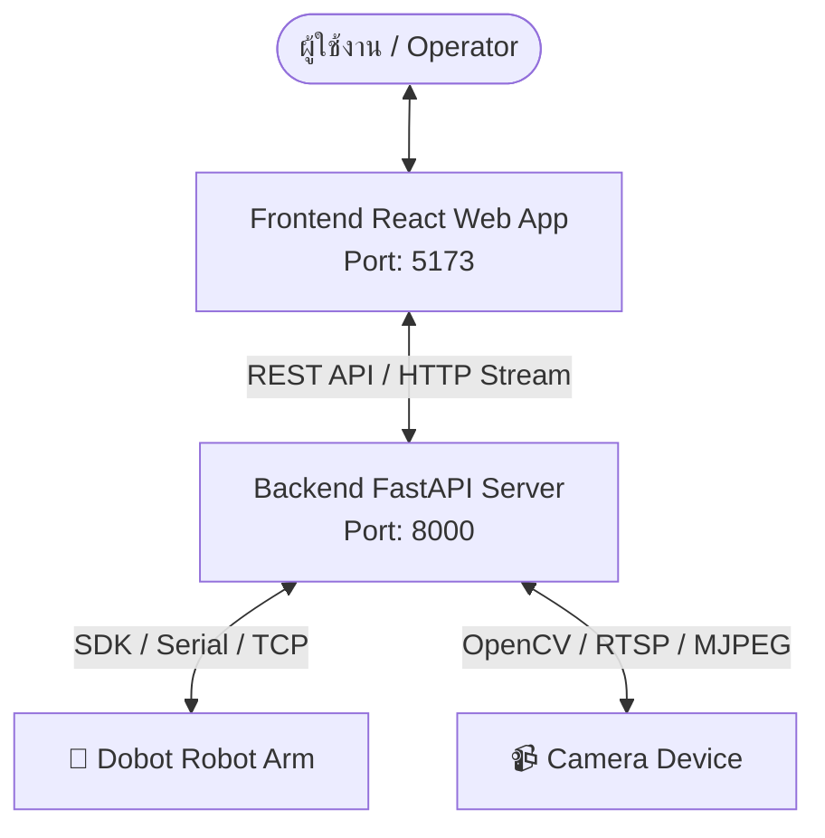

# 🤖 Web Robot - Control Center & Dashboard for Robotic Arm

**Web Robot** คือเว็บแอปพลิเคชันสำหรับควบคุมและติดตามสถานะของหุ่นยนต์แขนกล (Robot Arm / Dobot) แบบเรียลไทม์ผ่านหน้าเว็บแบบ Interactive รองรับการสั่งงาน Jog Control, ดูภาพกล้องสด (Camera Stream), โหมดวาดภาพ (Drawing Mode), และมีระบบคำสั่งหยุดฉุกเฉิน (Emergency Stop) เพื่อความปลอดภัยสูงสุด

---

## 🌟 ฟีเจอร์หลัก (Key Features)

- 🎮 **Dobot Controller (การควบคุมหุ่นยนต์)**
  - **Cartesian Control**: ควบคุมตำแหน่งพิกัด X, Y, Z, RX, RY, RZ
  - **Joint Control**: ควบคุมมุมข้อต่อ J1, J2, J3, J4, J5, J6
  - **Step Value Selection**: ปรับระยะการเคลื่อนที่ได้ตั้งแต่ 0.1, 1, 5, ถึง 10 mm/deg
  - **Live Coordinate Readout**: แสดงตำแหน่งพิกัดปัจจุบันและมุมข้อต่อแบบ Real-time
  - **3D Model Viewer**: รองรับการจำลองท่าทางหุ่นยนต์ในรูปแบบ 3D
- 📹 **Real-Time Camera Stream**
  - สตรีมภาพวิดีโอสดจากกล้องที่ติดตั้งกับหุ่นยนต์ (MJPEG Stream)
  - รองรับการบันทึกภาพนิ่ง (Snapshot Capture)
- 🎨 **Drawing Mode (โหมดวาดภาพ)**
  - สร้างและส่ง Trajectory การวาดภาพไปยังแขนกล
- 🚨 **Safety & Emergency Stop**
  - ปุ่มหยุดฉุกเฉิน (E-Stop) ที่เข้าถึงได้ทันทีจากทุกหน้าเพจเพื่อตัดการทำงานทันที
- 📊 **Dashboard & Analytics**
  - แสดงภาพรวมสถานะการเชื่อมต่อ และการทำงานของระบบ
- ⚙️ **System Settings**
  - ตั้งค่าการเชื่อมต่อ API, พอร์ตสื่อสาร Serial/TCP, และกล้อง

---

## 🛠️ เทคโนโลยีที่ใช้ (Tech Stack)

### **Frontend**
- **Framework**: [React 19](https://react.dev/) + [Vite](https://vitejs.dev/)
- **Routing**: [React Router DOM v7](https://reactrouter.com/)
- **Styling**: Vanilla CSS (Modern Dark Mode UI / Custom Design System)
- **Linting**: [Oxlint](https://oxc.rs/)

### **Backend**
- **Framework**: [FastAPI](https://fastapi.tiangolo.com/) (Python 3.10+)
- **Server**: [Uvicorn](https://www.uvicorn.org/)
- **Data Validation**: [Pydantic](https://docs.pydantic.dev/)
- **CORS Middleware**: รองรับ Cross-Origin Request จาก Frontend React

---

## 📂 โครงสร้างโปรเจกต์ (Project Structure)

```text
web_robot/
├── README.md                 # เอกสารอธิบายโครงการ
├── backend/                  # ส่วนของ Backend Server (FastAPI)
│   ├── main.py               # จุดเริ่มต้นของ FastAPI App & CORS Config
│   ├── requirements.txt      # รายการ Dependencies ของ Python
│   ├── run.bat               # Script สำหรับรัน Backend Server บน Windows
│   └── routers/              # API Route Handlers
│       ├── __init__.py
│       ├── auth.py           # API เข้าสู่ระบบ / ออกจากระบบ (/api/auth)
│       ├── camera.py         # API สตรีมกล้องและแคปเจอร์ภาพ (/api/camera)
│       └── robot.py          # API ควบคุมพิกัดและสถานะหุ่นยนต์ (/api/robot)
└── frontend/                 # ส่วนของ Frontend Web App (React + Vite)
    ├── index.html            # HTML Entry Point
    ├── package.json          # รายการ Dependencies และ Scripts ของ Node.js
    ├── vite.config.js        # การตั้งค่า Vite
    ├── .oxlintrc.json        # การตั้งค่า Oxlint
    └── src/
        ├── App.jsx           # Main App Component & Client Routing
        ├── main.jsx          # React Entry Point
        ├── index.css         # Design System & Global Styles
        ├── components/       # UI Components ส่วนกลาง
        │   ├── Sidebar.jsx   # แถบเมนูด้านข้าง
        │   └── TopBar.jsx    # แถบหัวเรื่องด้านบน + ปุ่ม Emergency Stop
        └── pages/            # หน้าเว็บแต่ละหน้า
            ├── LoginPage.jsx          # หน้าเข้าสู่ระบบ (/login)
            ├── DashboardPage.jsx      # หน้าภาพรวมระบบ (/dashboard)
            ├── DobotControllerPage.jsx# หน้าควบคุมหุ่นยนต์ Dobot (/dobot)
            ├── CameraViewPage.jsx     # หน้าดูกล้องสด (/camera)
            ├── DrawingModePage.jsx    # หน้าโหมดวาดภาพ (/drawing)
            └── SystemSettingsPage.jsx # หน้าตั้งค่าระบบ (/settings)
```

---

## 🏗️ สถาปัตยกรรมระบบ (System Architecture)



---

## 🚀 ขั้นตอนการติดตั้งและการใช้งาน (Installation & Setup)

### 📋 ความต้องการของระบบ (Prerequisites)
- **Node.js** v18.0.0 ขึ้นไป
- **Python** 3.10 ขึ้นไป
- **Git**

---

### 1️⃣ การติดตั้งและรัน Backend (FastAPI)

1. เข้าไปยังโฟลเดอร์ `backend`:
   ```bash
   cd backend
   ```

2. สร้าง Virtual Environment (แนะนำ):
   ```bash
   python -m venv venv
   ```
   *เปิดใช้งาน Virtual Environment:*
   - **Windows**: `venv\Scripts\activate`
   - **macOS/Linux**: `source venv/bin/activate`

3. ติดตั้ง Dependencies:
   ```bash
   pip install -r requirements.txt
   ```

4. เริ่มต้นทำงาน Backend Server:
   - **วิธีที่ 1 (Windows Script)**:
     ```cmd
     run.bat
     ```
   - **วิธีที่ 2 (ผ่าน Uvicorn Command)**:
     ```bash
     uvicorn main:app --reload --host 0.0.0.0 --port 8000
     ```

   > 🌐 **Backend API**: `http://localhost:8000`  
   > 📑 **Interactive API Docs (Swagger UI)**: `http://localhost:8000/docs`

---

### 2️⃣ การติดตั้งและรัน Frontend (React + Vite)

1. เปิด Terminal ใหม่ และเข้าไปยังโฟลเดอร์ `frontend`:
   ```bash
   cd frontend
   ```

2. ติดตั้ง Node Modules:
   ```bash
   npm install
   ```

3. เริ่มต้นทำงาน Development Server:
   ```bash
   npm run dev
   ```

4. เปิดบราวเซอร์เพื่อเข้าใช้งานเว็บแอปพลิเคชัน:
   > 🔗 **Web Interface**: `http://localhost:5173`

---

## 📡 รายละเอียด API Endpoints

### 🔑 Authentication (`/api/auth`)
| Method | Endpoint | Description | Request Body / Query |
| :--- | :--- | :--- | :--- |
| `POST` | `/api/auth/login` | เข้าสู่ระบบ | `{ "username": "admin", "password": "..." }` |
| `POST` | `/api/auth/logout` | ออกจากระบบ | - |

---

### 🤖 Robot Control (`/api/robot`)
| Method | Endpoint | Description | Request Body / Query |
| :--- | :--- | :--- | :--- |
| `POST` | `/api/robot/move` | ขยับพิกัด Cartesian หรือ Joint | `{ "axis": "X", "direction": "+", "step": 1.0 }` |
| `POST` | `/api/robot/emergency-stop` | สั่งหยุดหุ่นยนต์ฉุกเฉินทันที | - |
| `POST` | `/api/robot/draw` | ส่งชุดคำสั่งวาดภาพ | `{ ... }` |
| `GET` | `/api/robot/status` | ดึงสถานะและพิกัดปัจจุบัน | ตอบกลับตำแหน่ง `(x, y, z)` และมุม `(j1..j6)` |

---

### 📹 Camera Control (`/api/camera`)
| Method | Endpoint | Description | Response |
| :--- | :--- | :--- | :--- |
| `GET` | `/api/camera/stream` | สตรีมวิดีโอสดจากกล้อง | `multipart/x-mixed-replace` (MJPEG) |
| `GET` | `/api/camera/snapshot` | ดึงภาพนิ่ง ณ เวลาปัจจุบัน | `image/jpeg` |

---

## 🗺️ เส้นทางการนำทางในแอปพลิเคชัน (Frontend Routes)

| Path | Component | หน้าที่การทำงาน |
| :--- | :--- | :--- |
| `/login` | [LoginPage](file:///e:/code/web_robot/frontend/src/pages/LoginPage.jsx) | หน้า Login เข้าใช้งานระบบ |
| `/dashboard` | [DashboardPage](file:///e:/code/web_robot/frontend/src/pages/DashboardPage.jsx) | หน้าสรุปภาพรวมและสถานะการเชื่อมต่อ |
| `/dobot` | [DobotControllerPage](file:///e:/code/web_robot/frontend/src/pages/DobotControllerPage.jsx) | หน้าแผงควบคุม Jog Control (Cartesian & Joint), Step value, พิกัดแบบ Real-time และ 3D View |
| `/camera` | [CameraViewPage](file:///e:/code/web_robot/frontend/src/pages/CameraViewPage.jsx) | หน้าดูกล้องสดและบันทึกภาพ Snapshot |
| `/drawing` | [DrawingModePage](file:///e:/code/web_robot/frontend/src/pages/DrawingModePage.jsx) | หน้าวาดภาพ/กำหนดทิศทาง Trajectory |
| `/settings` | [SystemSettingsPage](file:///e:/code/web_robot/frontend/src/pages/SystemSettingsPage.jsx) | หน้ากำหนดค่าระบบ API, Serial Port, Baudrate |

---

## 🧪 การตรวจสอบโค้ดและสร้าง Build (Development & Build)

- **ตรวจสอบ Linting ใน Frontend**:
  ```bash
  cd frontend
  npm run lint
  ```
- **สร้าง Production Build สำหรับ Frontend**:
  ```bash
  cd frontend
  npm run build
  ```
- **ทดสอบเปิด Production Preview**:
  ```bash
  npm run preview
  ```

---

## 🛡️ ความปลอดภัยและการรับรองสิทธิ์ (Security & Safety)

1. **Emergency Stop (E-Stop)**: ออกแบบให้เรียกผ่าน HTTP POST ทันทีเมื่อผู้ใช้กดปุ่ม E-Stop แถบด้านบน
2. **CORS Security**: Backend ถูกตั้งค่าเริ่มต้นให้ยอมรับการเชื่อมต่อจาก `http://localhost:5173` เท่านั้น สามารถปรับแต่งเพิ่มเติมได้ใน [backend/main.py](file:///e:/code/web_robot/backend/main.py)

---

## 📄 License & Credits

พัฒนาขึ้นสำหรับการเชื่อมต่อและควบคุมหุ่นยนต์แขนกล Dobot ผ่าน Web Technologies (FastAPI + React)
